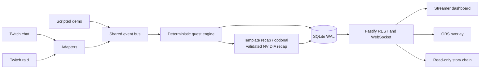

# Raid Relay

Raid Relay turns the first minute after a Twitch raid into a shared story and vote. Raiders get quick context, join the incoming party, and help decide what happens next.

## Quick start: simulated demo

Requirements: Node.js 20 or newer and pnpm 11.25.0.

```sh
pnpm install --frozen-lockfile
cp .env.example .env
```

Edit `.env` and set at least:

```dotenv
CHANNELS=channel_a_login,channel_b_login
DASHBOARD_TOKEN=choose-a-private-dashboard-token
OVERLAY_KEY=choose-a-private-overlay-key
VOTER_HASH_SALT=choose-a-random-value-of-at-least-16-characters
DEMO_MODE=true
```

The example channel names are local demo channels; Twitch credentials are not needed for this mode. Start the API and web app:

```sh
pnpm dev
```

Open the source-channel dashboard (replace the placeholders with your `.env` values):

```text
http://localhost:5173/dashboard/channel_a_login?token=YOUR_DASHBOARD_TOKEN&overlayKey=YOUR_OVERLAY_KEY
```

The **Run full demo** button appears when demo mode is enabled and the configured channels have no active quests. If a quest is stuck or you want to clear the channel, use **Abandon quest**; it records an abandoned terminal state in the story chain. The demo button then runs a simulated A-to-B story through the same event bus and configured SQLite database used by the app.

Open the stream-facing overlay for either channel using **Open preview** in the dashboard, or open these routes directly:

```text
http://localhost:5173/overlay/channel_a_login?key=YOUR_OVERLAY_KEY
http://localhost:5173/overlay/channel_b_login?key=YOUR_OVERLAY_KEY
```

The overlay is the view to inspect or add to OBS as a Browser Source; the dashboard is for streamer controls. After a run, `/chain` lists persisted stories and `/chain/<quest-id>` shows one story. The interactive demo takes about 25–30 seconds with the example welcome and vote timings. It labels scripted inputs **SIMULATED** and does not connect to Twitch.

The standalone CLI also runs the complete deterministic scenario against a fresh in-memory SQLite database and prints its result and events:

```sh
pnpm demo
```

Each CLI invocation starts with a clean database, so it can be run repeatedly. It does not start the web app; use the dashboard button when you want to watch the story update in the overlay and chain pages.

## Optional: connect Twitch

For live chat and raids, create a Twitch developer application. Set `TWITCH_CLIENT_ID`, `TWITCH_CLIENT_SECRET`, and the exact registered `TWITCH_REDIRECT_URI` in `.env`. Set `CHANNELS` to the two broadcaster logins. Authorize each broadcaster separately; each configured broadcaster needs its own user token for its outgoing raid subscription:

```sh
pnpm twitch:auth
```

Run the smoke listener in a second terminal:

```sh
pnpm twitch:smoke
```

It prints hashed identifiers and raid viewer counts, never chat text or raw user identifiers. Chat uses `user:read:chat`. Read [docs/TWITCH_NOTES.md](docs/TWITCH_NOTES.md) for the documented scope and subscription details. Live delivery, actual raid viewer counts, and unexpected-disconnect recovery have not been verified against the project's authorized channels; see the remaining `TODO(verify)` items there.

## Optional: NVIDIA recap

The deterministic two-sentence recap works without an external provider. To try the optional NVIDIA provider, set `AI_ENABLED=true`, `NVIDIA_API_KEY`, and `AI_MODEL` in `.env`; `AI_MODEL` must exactly match an NVIDIA model ID. Provider output is schema-checked and fact-checked; any timeout, provider error, or invalid response falls back to the template and logs a short diagnostic in the server terminal. The request timeout defaults to 20 seconds. No chat messages, voter identifiers, or secrets are sent as recap facts. Live NVIDIA inference has not been verified for this project.

## How it works



The engine owns all state transitions, faction assignment, vote aggregation, and outcomes. The optional recap provider can only write a validated recap from supplied engine facts. See [docs/RULES.md](docs/RULES.md) for scoring and voting details.

## Real and simulated behavior

| Feature                                                     | Current status                         | Notes                                                               |
| ----------------------------------------------------------- | -------------------------------------- | ------------------------------------------------------------------- |
| Quest state, naming, vote resolution, party tiers, outcomes | Deterministic                          | Covered by unit and integration tests.                              |
| Browser **Run full demo**                                   | Simulated                              | Same event bus and configured SQLite store; marked in the overlay.  |
| `pnpm demo`                                                 | Simulated                              | Fresh in-memory SQLite run; prints completion and chain events.     |
| Twitch chat and raid adapters                               | Implemented, live verification pending | Requires credentials and separately authorized broadcaster tokens.  |
| NVIDIA recap                                                | Optional, live verification pending    | Template fallback remains available.                                |
| Public chain                                                | Persisted app data                     | Read-only; does not expose voter identifiers or rejected proposals. |

## Development and checks

```sh
pnpm typecheck
pnpm lint
pnpm test
pnpm build
pnpm format:check
```

WebSocket tests that bind local sockets need loopback access. In restricted environments those tests may fail with `listen EPERM`; this is an environment limitation, not a passing test result.

## Limitations and privacy

Twitch reports a raid viewer count, not the identity of every raider. Incoming-party attribution uses observed source-channel participation (name proposals, votes, or `!join`) or an explicit `!join` in the target channel during welcome or beat-two voting. It cannot prove which people arrived in the raid. Only hashed voter keys and valid command data are persisted; chat history and raw Twitch user identifiers are not stored.

Keep `.env`, `.data/twitch-tokens.json`, and the SQLite database private. They are ignored by Git. Do not paste dashboard or overlay keys into public issues or screenshots.

## Project documents

- [Codex build log](docs/CODEX_LOG.md)
- [Decisions](docs/DECISIONS.md)
- [Twitch verification notes](docs/TWITCH_NOTES.md)
- [Devpost draft](docs/DEVPOST.md)
- [Demo shot list](docs/DEMO_SCRIPT.md)
- [Submission checklist](docs/SUBMISSION_CHECKLIST.md)
